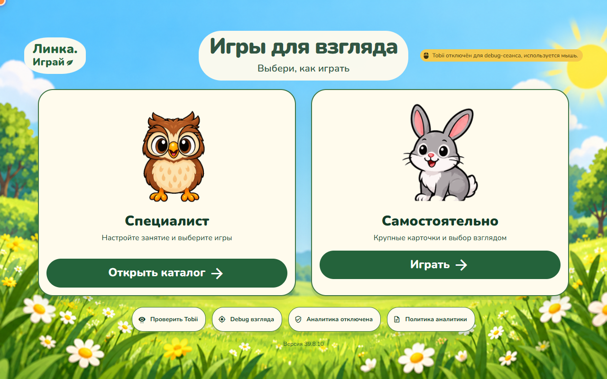
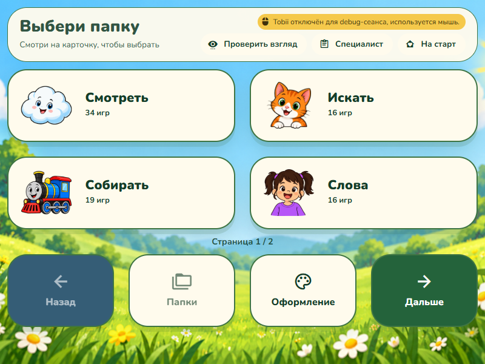
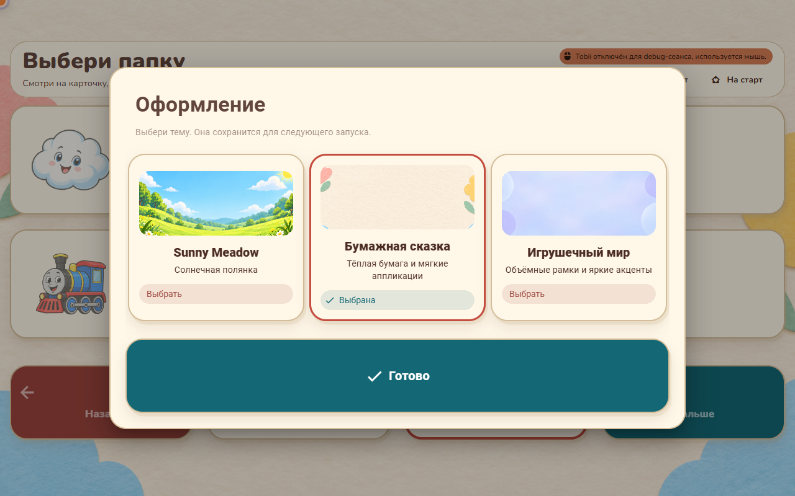
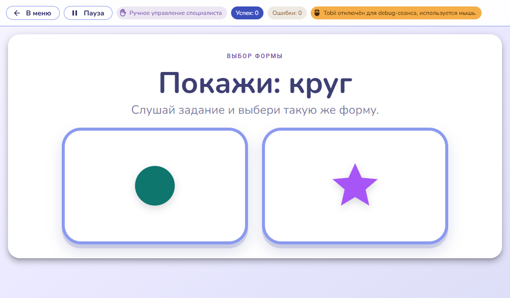

# Приёмка трёх тем

Дата: 31 октября 2026. Windows, Electron 39.8.10, Vue 3 / Vuetify 3.
Изолированный профиль, `LINKA_NO_TOBII=1`; это проверка настоящего Electron через CDP.

## Результат

- Sunny Meadow по умолчанию; Paper Story и Toy World доступны в обоих меню.
- Выбор применяется сразу и сохраняется после перезагрузки renderer.
- Главная, меню, общие компоненты, DOM/SVG и Canvas используют единый контракт тем.
- Все 640 существовавших изображений совпадают по SHA-256 с исходным набором.
  Новые изображения — только три фона тем. Набор персонажей взят из `73d3fd3`,
  совмещённого с актуальным main; эта ранее существовавшая ветка входит в PR.
- Прозрачные игровые цели исключены из общих рамок и теней. Иначе рамка создавала
  лишнюю видимую поверхность вокруг фигур и расходилась с их shape selector.

## Проверки

| Проверка | Результат |
| --- | --- |
| TypeScript renderer и Electron | пройдено |
| Unit suite | 148 файлов, 795 тестов пройдены |
| Повторный узкий прогон после исправления прозрачных целей | 2 файла, 5 тестов пройдены |
| `lint:adaptive-layout` | пройдено, новых жёстких px в стилях нет |
| Renderer + Electron build | пройдено |
| `smoke:renderer-assets` | 11 ресурсов, включая фоны, шрифт и OFL |
| Все registry-маршруты | 136 × 3 = 408 проверок, без ошибок renderer и битых DOM-изображений |
| Проверка компоновки пилотов | 8 маршрутов × 3 размера × 3 темы = 72, без замечаний аудитора |
| Самостоятельное меню и диалог тем | 24 экрана, 109 активных целей; обрезанных целей и горизонтального переполнения нет |
| Минимум активных целей меню/диалога в этой выборке | ширина 166 CSS px, высота 120 CSS px |
| Вспомогательные экраны | debug, калибровка, planned fallback × 3 темы = 9 |
| Дополнительные игровые экраны | 15 снимков, включая ракушки, укрытия, музыкальную дорожку и действия |
| Мышь / dwell | выбор, закрытие, блокировка фоновых целей, восстановление после reload — пройдено |
| Узкий экран | переход между превью и выбор другой темы — пройдено |
| Локальные файлы сборки в Electron (`file://`) | 3 темы, Sunny Meadow при первом запуске, reload persistence, Nunito и картинки без удалённых ресурсов — пройдено |

Пилоты: главная, оба меню, кормление, бабочки, облака, выбор формы и шашки.
Размеры пилотов: 800×600, 1024×600, 1600×900. Дополнительно меню и диалог проверены
при 900×600, 1280×800 с эмуляцией DPR 1.5 и 390×844. DPR — эмуляция Chromium,
а не отдельная проверка системного масштабирования Windows.

Каталог специалиста допускает обычную прокрутку для взрослых. Самостоятельное
меню использует страницы; на узком экране на странице одна карточка. Сохранены
поиск, фильтрация по папкам и параметры занятия. Учебные цвета и игровые правила
остаются содержимым заданий и не заменяются декоративной палитрой.

## Зоны взгляда и существующее ограничение

`audit:gaze` проверен для самостоятельного меню, кормления, выбора формы и
«Кто спрятался» во всех трёх темах. Первые три маршрута проходят без замечаний.
В «Кто спрятался» остаются две цели первого раунда меньше registry-минимума 170 px:
утка и кот. Для проверки происхождения отдельно собран **исходный `ced92d1`** и
прогнан тем же аудитором при 1280×800: в нём те же две цели меньше минимума
(138 и 134 px). В темах — примерно 135–137 и 131–132 px, с учётом нового шрифта
и адаптивного вписывания под HUD. Новых замечаний о покрытии нарисованной фигуры
или расстояниях между целями после исправления прозрачных кнопок нет.

Этот существовавший дефицит размера не исправлялся изменением сложности,
расположения персонажей или registry-порога в задаче оформления. Его нужно учитывать
при дальнейшей приёмке этой игры с айтрекером. Сохранены отчёты исходной и новой версии.

## Границы проверки

- Smoke подтверждает загрузку и начальный экран/запуск режима, а не прохождение
  всех раундов 136 игр. Canvas-арты проверены просмотром представительных сцен;
  список битых DOM-картинок не является полной проверкой каждого Canvas-ресурса.
- Физический Tobii не подключался. Калибровка, точность устройства и терапевтическая
  пригодность тем требуют отдельного прогона с пользователем и специалистом.
- Установщик и публикация релиза не выполнялись. Vite сохраняет предупреждение
  о крупном общем JS chunk; разделение существующего bundle не входит в оформление.

Команды и схема уровней стилей: [appearance-themes.md](../../appearance-themes.md).
Машиночитаемые результаты и выбранные реальные Electron PNG находятся рядом с этим отчётом.

