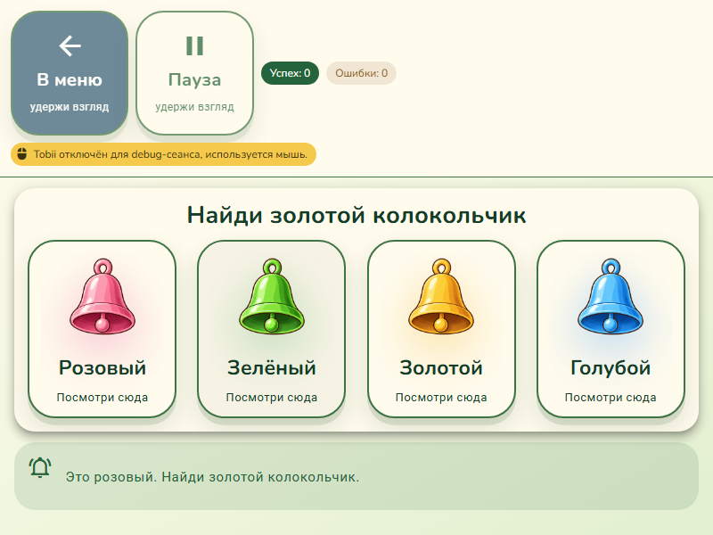
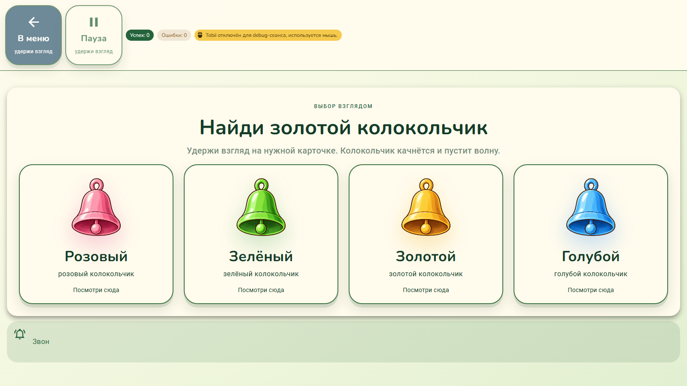
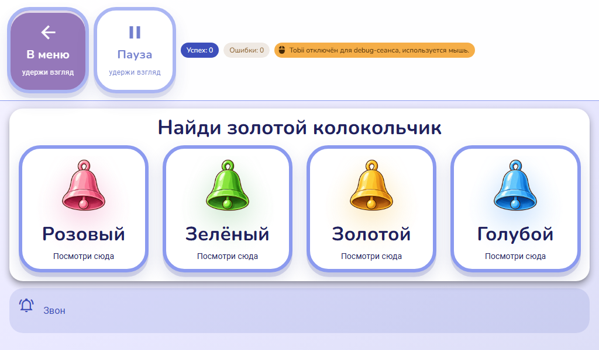

# Колокольчики: иллюстрации и неподвижное поле

Проверено 1 ноября 2026 года в настоящем Electron BrowserWindow через CDP,
Vite 5174 / CDP 9223. Физический Tobii отключён; выбор проверен мышью и
синтетической фиксацией через действующий dwell coordinator.

## Изменение

Вместо контурной иконки добавлены четыре согласованные прозрачные иллюстрации.
Сообщение вынесено под рамку в постоянную область: появление текста больше
не меняет высоту строки, которую измеряет `fitGameBelowHud`, и не запускает
масштабирование игрового поля. На коротких окнах 2–4 карточки располагаются
в один ряд; второстепенный текст скрывается, чтобы сохранить место для целей.

## Проверки

| Проверка | Результат |
| --- | --- |
| `npm run typecheck` | Успешно |
| `npm run lint:adaptive-layout` | Успешно |
| Prettier для изменённого Vue-файла, `git diff --check` | Успешно |
| 800×600, 1024×600, 1600×900 × самостоятельный/специалист × 2/3/4 карточки | Все 18 конфигураций прошли |
| «Звон», длинное сообщение об ошибке, исчезновение сообщения | 288 замеров: координаты рамки, карточек, области сообщения и zoom точно совпали с исходными |
| Границы карточек, положение относительно HUD, загрузка изображений | Все проверенные конфигурации прошли |
| Мышь, синтетическая фиксация, восемь раундов и перезапуск | Прошли |
| Пауза, уменьшение движения в приложении | Анимация останавливается/отключается |
| Системный `prefers-reduced-motion: reduce` | Анимация отключается |
| Область уведомления | Постоянные `role=status`, `aria-live=polite`, без `aria-hidden`; между сообщениями пустая |
| Paper Story и Toy World, 1024×600, четыре карточки | PNG просмотрены |

После финальной правки live region и CSS уменьшения движения повторно
проверены положение при показе/скрытии длинного сообщения для 2/3/4 карточек
на 800×600 и системное отключение анимации.

Общий `electron-cdp-smoke.mjs` также запускался, но завершился с двумя
ошибками на трёх размерах: его HUD-эвристика включает контейнер
`game-hud-clear` и собственные кнопки HUD в игровые цели. На большом окне
фиксированная задержка этого скрипта дала пустой снимок и ноль целей.
Поэтому результат общего аудита не считается успешным. Для этой задачи
использованы ожидание готового компонента, отдельные замеры настоящих
игровых карточек и просмотр непустых PNG. Общий аудит и геометрия Tobii
(отложенный #59) этим изменением не исправляются.

## Снимки настоящего Electron

## Иллюстрации и генерация

Режим: встроенный ImageGen, редактирование референса, прозрачный фон.
Отдельный вызов на каждый колокольчик. Результаты скопированы без обработки
растра; Pillow использован только для проверки размеров и альфа-канала.
Каждый файл — PNG RGBA 1254×1254 с прозрачностью (alpha 0–255).

Файлы результата:

- `public/images/bells/bell-gold.png`
- `public/images/bells/bell-blue.png`
- `public/images/bells/bell-pink.png`
- `public/images/bells/bell-green.png`

Содержание запросов: один красивый музыкальный колокольчик для спокойной
детской игры, изолированный на настоящем прозрачном фоне; полная расширенная
книзу форма, верхняя петля и видимый круглый язычок. Почти фронтальный вид
слегка снизу, мягкие блики и округлый тёплый тёмно-коричневый контур,
читаемость при небольшом размере. Без лица, персонажа, ручки, банта, звёзд,
нот, надписей, водяного знака, фона и тени на земле; ровные прозрачные поля.

Для золотого использованы `public/images/words/bell.png` как референс
предмета и `public/images/open-door/door-leaf-v2.png` только как референс
рисованного стиля. Цвет — медово-золотой с кремовыми бликами. Дверь не
включать в результат.

Для остальных трёх использован новый золотой колокольчик как референс:
менять только цвет металла корпуса, ободка, петли и язычка на голубой,
розовый или зелёный; сохранять форму, пропорции, ракурс, контур, блики,
композицию и прозрачные поля. Не оставлять доминирующий золотой цвет,
не добавлять предметы или декор.

## Ограничения

Слуховая оценка звука и физический трекер этим UI-прогоном не проверялись.
Правила раундов, аудио и обработчики выбора не изменены.
