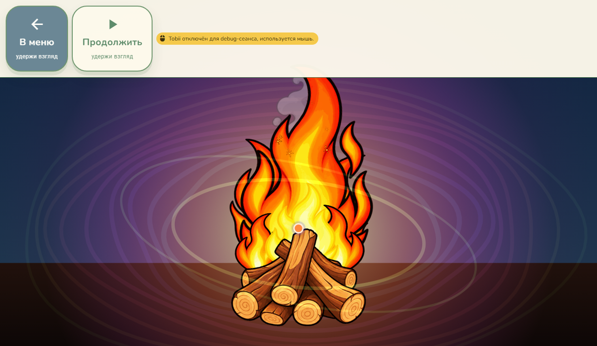
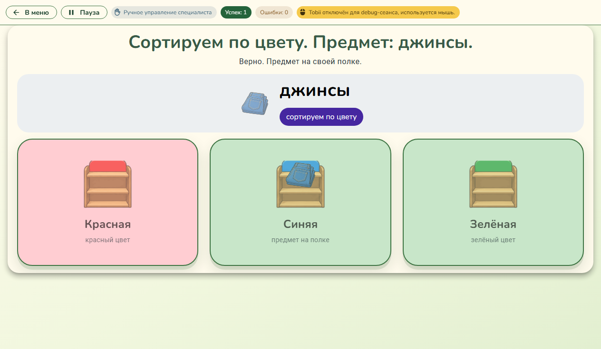
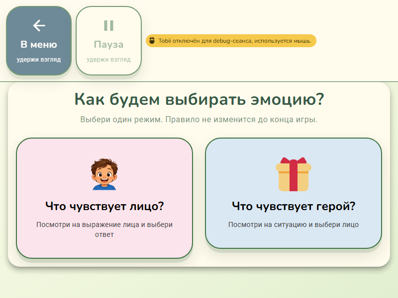
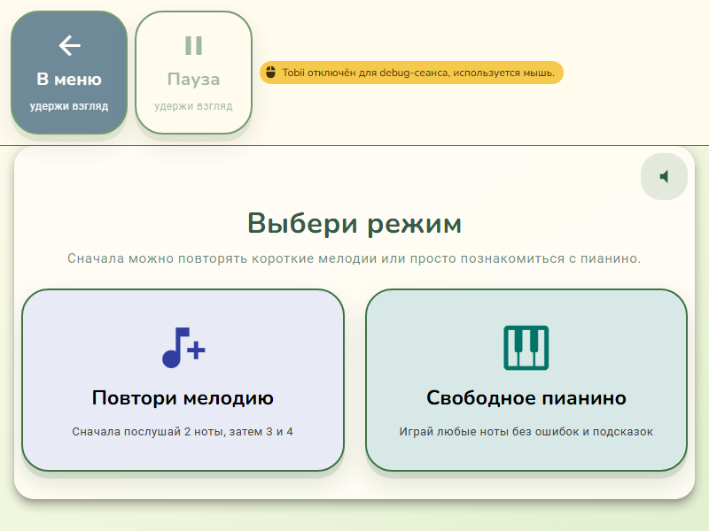

# Проверка Issues #39, #42, #48 и #62

Дата: 1 ноября 2026 года. База: `main`, `0b97cca39fb3e3ffba7ab2848afff012841ed16a`.
Проверки UI выполнены в Windows, Electron 39.8.10, через CDP настоящего Electron.
Использован отдельный тестовый профиль, Tobii отключён. Проверка аппаратной геометрии #59 отложена.

## Результаты

| Issue | Результат |
| --- | --- |
| #39 | Использовано существующее исправление PR #40 (`affd693`), без повторной реализации. Проверены обе игры на актуальной базе. |
| #42 | Не воспроизводится на текущей базе. Изображение цветной полки уже выводится независимо от состояния успешного размещения. |
| #48 | Подтверждено и исправлено: пламя и частицы используют останавливаемое игровое время; отдельные частицы `fireArt.ts` очищаются при перезапуске и выходе. |
| #62 | Исправлены три экрана: «Выбери эмоцию», «Категории слов», «Сольфеджио». Общая панель доступна до выбора режима, пауза отключена до старта, сессия остаётся `idle`. |

## #39: проверка существующего PR #40

- «Найди животное»: пауза после запуска таймера перехода сохраняет текущий раунд; продолжение завершает переход один раз.
- Пауза во время ожидания озвучки также не пропускает раунд.
- Перезапуск во время ожидания отменяет старое продолжение.
- «Покорми зверька»: после 500 мс ожидания пауза на 2500 мс не меняет раунд и сохраняет блокировку ответа. После продолжения отсчитывается оставшаяся часть задержки, затем открывается следующий раунд.

Новые изменения для #48 и #62 независимы от PR #40. Его код не включается повторно в новый PR.

## #48: костёр

До исправления на паузе менялись пиксели canvas и появлялись новые частицы.
После исправления два снимка canvas, разделённые паузой 1300 мс, побайтово одинаковы;
игровое время и число частиц не меняются. После продолжения изображение снова меняется,
время паузы не добавляется к анимации.

Проверены перезапуск и повторный вход. Модульные тесты дополнительно проверяют неподвижность
нарисованных частиц при постоянном времени и отсутствие старого дыма, искр и накопленного
интервала появления частиц после сброса.

## #42: сортировка по полкам

В цветовом раунде до и во время успешного размещения присутствуют все три изображения полок.
В правильной карточке одновременно видны изображение полки и размещённый предмет.
Дополнительная правка исходников игры не потребовалась.

## #62: навигация и похожие экраны

Структурная проверка Vue-компонентов всех игр выявила только три случая условного скрытия
`GameHud`/`GameSessionChrome`: `choose-emotion`, `word-categories`, `solfege`.

Во всех трёх играх проверены:

- «В меню» до выбора режима, в самостоятельном режиме и режиме специалиста; сохраняется категория исходного меню.
- Неактивная пауза до выбора: мышь и синтетические точки взгляда не запускают сессию; время равно нулю.
- Запуск обоих режимов каждой игры, пауза/продолжение и перезапуск.
- Возврат из «Сольфеджио» к выбору режима: старую сессию нельзя продолжить кнопкой панели.
- Выбор режима и возврат в меню синтетическими точками взгляда, проходящими через общий указатель и dwell-механизм. Это программная проверка, не проверка настоящего Tobii.

Для каждого из трёх экранов выбора проверены 800×600, 1024×600 и 1600×900 в обоих режимах
управления: 18 комбинаций. Панель и обе цели выбора видимы; цели не перекрываются панелью.
В «Сольфеджио» контейнер дополнительно подключён к общему `game-hud-clear`, чтобы панель
не перекрывала кнопку звука на маленьком окне.

## Автоматические проверки

- `npm run test:unit -- --maxWorkers=2 --reporter=verbose`: 150 файлов, 802 теста прошли. Прогон включает существующее исправление PR #40.
- `npm run typecheck`: пройдено.
- `npm run lint:adaptive-layout`: пройдено, новых жёстких `px` в стилях нет.
- Prettier для изменённых исходников и тестов: пройдено.
- `git diff --check`: пройдено.

На Windows для локального запуска теста release workflow восстановлен LF из `.editorconfig`;
содержательных изменений workflow нет.
