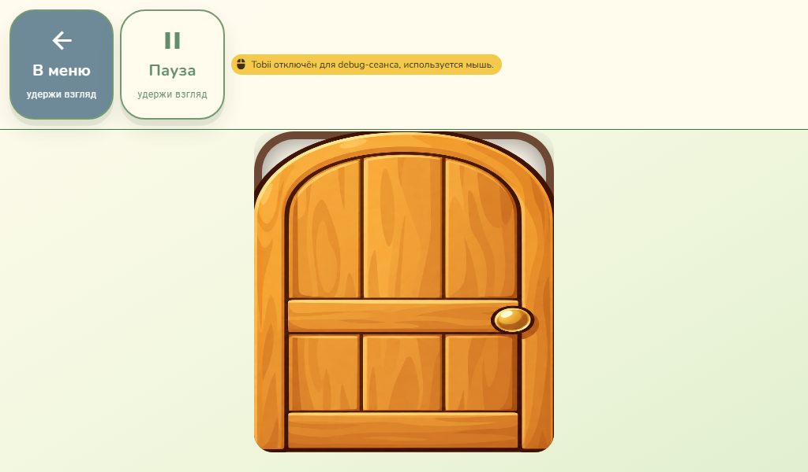
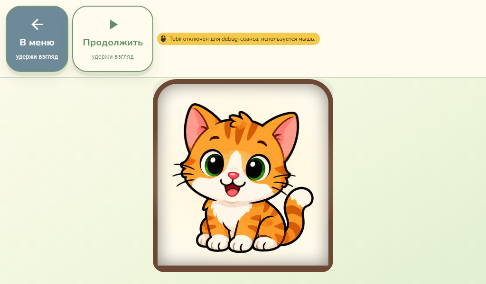
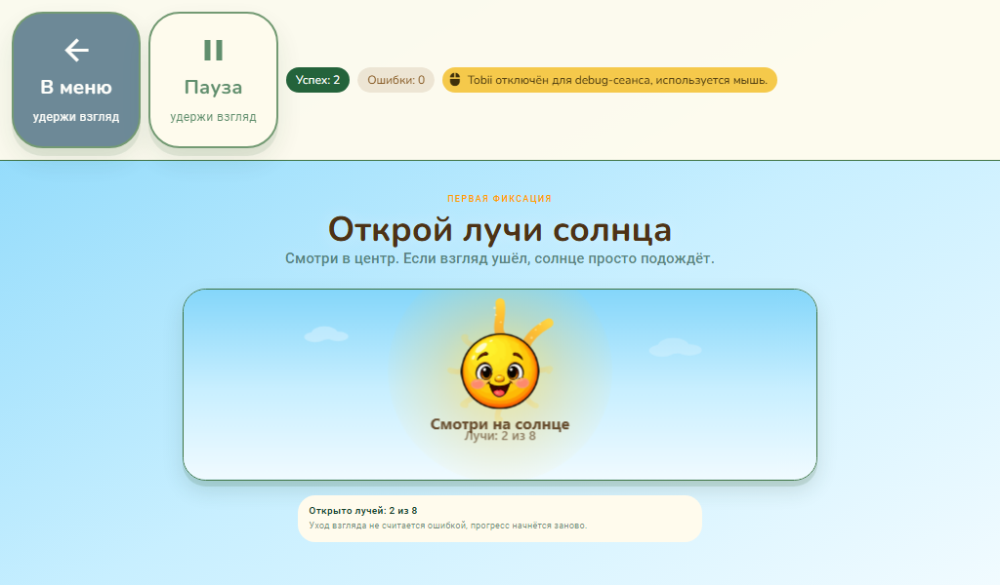
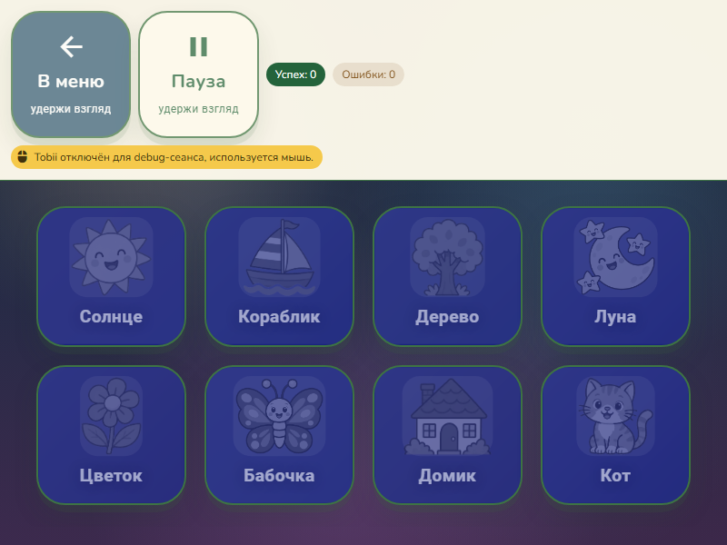
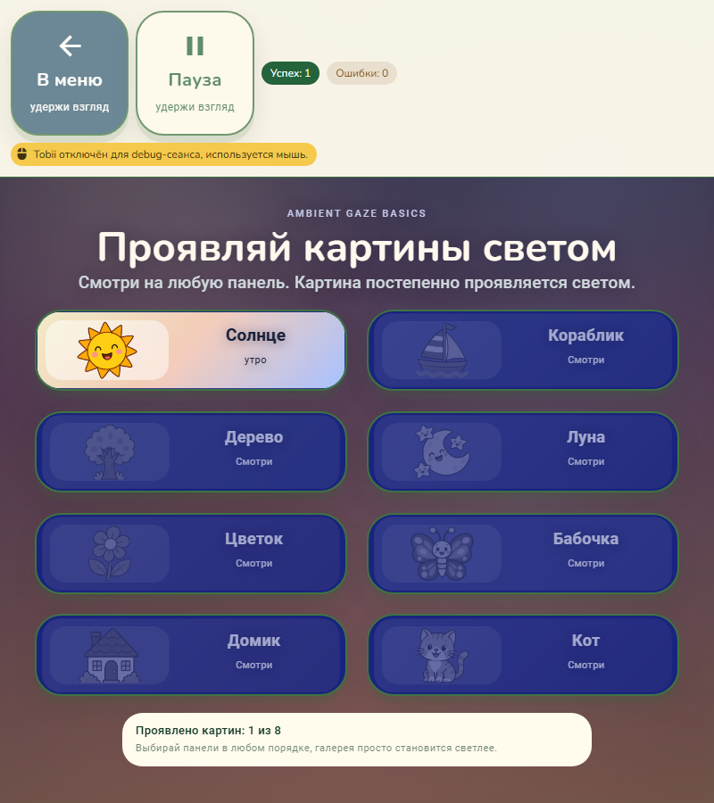
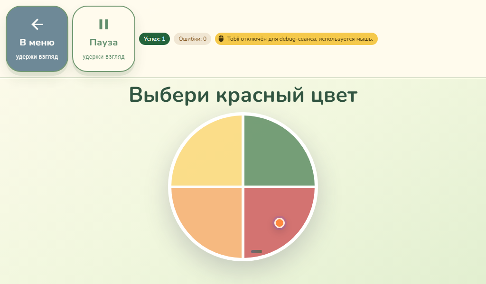
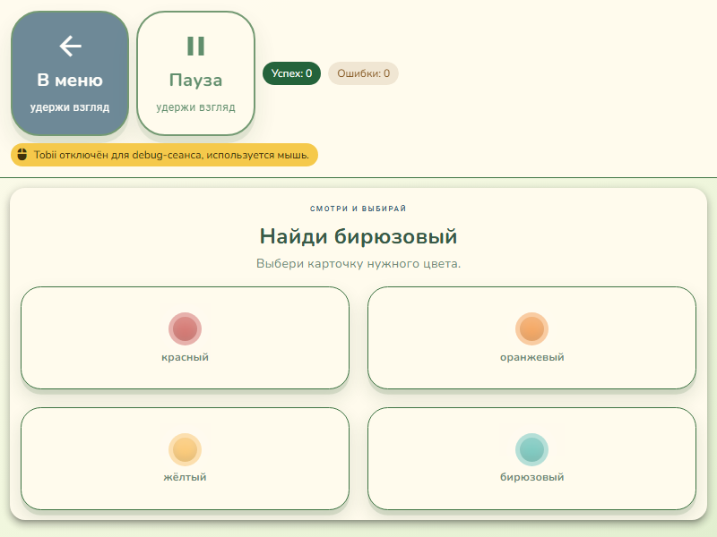
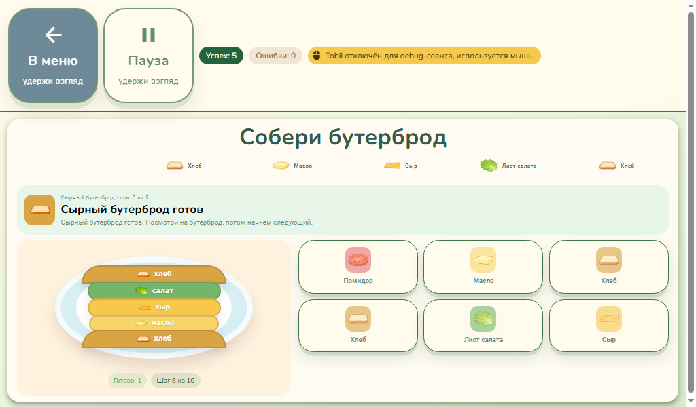
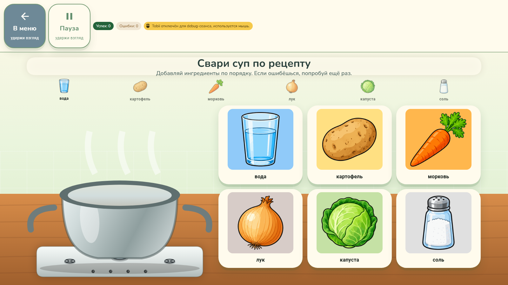
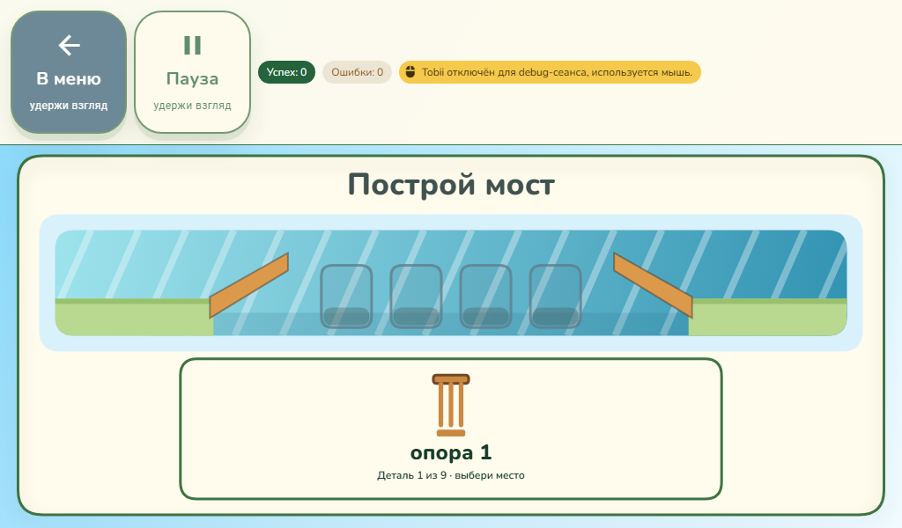

# Возврат в меню и визуальные исправления восьми игр

## Результат

Кнопка «В меню» в HUD и окне результата возвращает к исходной категории, поисковому запросу, странице и позиции прокрутки. При изменении размера окна страница пересчитывается по запущенной игре. Снимок используется только для подтверждённого запуска из меню; смена режима, калибровка и внешнее открытие игры его сбрасывают.

| Игра | Изменение |
| --- | --- |
| Открой дверцу | Новая нарисованная дверь, полное открытие, предварительная загрузка восьми наград, отсутствие затемнения disabled-карточки, персонаж целиком. Таймер показа останавливается на паузе. |
| Солнце и лучи | Яркие лучи с плавным появлением, движением и искрами; геометрия помещается в canvas. Пауза замораживает анимацию, reduced motion показывает статичное подходящее лицо. |
| Галерея света | Увеличены карточки, изображения и интервалы; все восемь карточек помещаются. В портретном окне изображение находится слева от текста. Исправлена читаемость проявленной карточки. |
| Цветной круг | Круг без прямоугольной подложки и квадратной подсветки. Видимые подписи секторов заменены доступными названиями, задание и образец цвета сохранены. |
| Найди цвет | Подписи помещаются в карточках, ограничены размер и перенос текста, использованы цвета общей темы. |
| Собери бутерброд | Два одинаковых ломтика с подписью «Хлеб»; любой принимается на обоих хлебных шагах. Внутренние роли слоёв сохранены. |
| Свари суп по рецепту | Заголовок и сетка учитывают реальную высоту HUD, ингредиенты увеличены, окно за кастрюлей убрано. Canvas и DOM используют одну геометрию. |
| Построй мост | Общий шрифт и цвета темы, деревянные детали, ограничение ширины текста, высота с учётом HUD. Убрана дублирующая подпись поверх мест установки. Также исправлены накопление dwell за время паузы и завершение игры во время паузы. |

## Проверки

- Полный локальный прогон до интеграции PR #40: **151 файл, 811 тестов прошли** (`npm.cmd run test:unit -- --maxWorkers=2 --reporter=verbose`).
- Целевой прогон моделей дверцы, моста, супа, бутерброда и возврата в меню: **37 тестов прошли**.
- TypeScript, Prettier изменённых исходников, `lint:adaptive-layout`, `git diff --check` прошли. Новых фиксированных px в стилях не добавлено.
- Для существующего теста `release-version-gate` локальные CRLF в `release.yml` временно нормализованы в LF; после прогона исходные байты восстановлены. Workflow не изменён.
- Три независимых read-only ревью: замечания исправлены, повторное ревью новых дефектов не выявило.

В ветку также включён оригинальный коммит `affd693438ea7c75dab9c98a572b792e2897cb0d` из PR #40 с сохранением авторства. Он переводит переходы раундов «Покорми животное» и «Найди животное» на игровые таймеры, отменяет устаревшие продолжения после перезапуска. После интеграции повторно прошли **21 целевой тест** (4 файла) и три Electron-сценария: пауза ожидающего перехода, пауза во время озвучки с последующим перезапуском, сохранение остатка задержки кормления. До этой серии оригинальные изменения уже проверялись вместе с PR #63 полным прогоном 802 тестов. Общий результат ветки дополнительно проходит обязательный GitHub CI.

Проверки интерфейса выполнены в настоящем Electron через его CDP, с отдельными userData, Vite 5174 и CDP 9223. Обычный браузер не использовался как доказательство Electron-layout. Физический Tobii не тестировался; gaze проверен синтетическими точками через настоящий dwell coordinator. #59 остаётся отложенным.

### Навигация и игровой сценарий

- Специалист: запрос «найди», страница 2, прокрутка 250 → игра → кнопка HUD → те же запрос, страница, игра и прокрутка.
- Самостоятельное меню 500×600: категория `language-aac`, страница 2, прокрутка 83 → игра → кнопка HUD → то же состояние.
- Изменение окна с 800×600 на 500×600 во время игры: запущенная игра остаётся на видимой странице.
- После смены режима и калибровки возврат ведёт в актуальный режим; deep link из открытого меню не использует старый снимок.
- Возврат из окна результата восстанавливает поиск «Солнце».
- Дверца: все восемь изображений загружаются и помещаются; opacity содержимого равен 1. Во время паузы дольше полного интервала показа дверца остаётся открытой. Пройдено восемь наград до результата.
- Солнце: canvas побайтно одинаков до/после ожидания на паузе, изменяется после продолжения. Reduced motion выбирает улыбку без застывшего WOW. Синтетический Tobii успешно открывает луч.
- Бутерброд: выбран «второй» ломтик на первом шаге и «первый» на последнем; 5 успехов, 0 ошибок, готовый бутерброд видим.
- Суп: весь рецепт пройден, 6 успехов, 0 ошибок.
- Мост: удержание сбрасывается при паузе; пауза не устанавливает деталь. После девятой детали результат ждёт продолжения.
- Цветной круг: настоящий mouse click через CDP выбирает верный сектор; у подсветки `::after` отсутствует квадрат. Проверенные подписи «Найди цвет» остаются внутри карточек.

### Размеры и оформление

Проверены восемь игр при 800×600, 1024×600 и 1600×900. Дополнительно галерея — 800×900 и 640×900; круг, поиск цвета и мост — темы Paper Story и Toy World при 1024×600. В отдельном прогоне после ожидания Vue mount все игровые DOM-кнопки находились ниже HUD и внутри окна, изображения загружены, горизонтального переполнения нет. В портретной галерее высота изображений 65–83 вместо нескольких пикселей.

Стандартный `audit:electron-cdp` также запущен с PNG и проверил 24 сочетания. Его автоматический итог **не зелёный: 14 failures**. Он ждёт фиксированные 900 мс и иногда снимает пустой экран до Vue mount; также считает собственные кнопки HUD игровыми целями и включает `.game-hud-clear` в прямоугольники HUD через `[class*="hud"]`. Поэтому его итог не использован как доказательство корректности. Проверка с ожиданием конкретного Vue-компонента, отдельным `.game-hud` и исключением его собственных кнопок выполнена дополнительно; её PNG просмотрены. Геометрию всего Tobii и этот инструмент в рамках #59 не меняли.

## Скриншоты

## Новый графический ресурс

Встроенный imagegen; прозрачный PNG без последующего редактирования: `public/images/open-door/door-leaf-v2.png`. Референсы: `open-door/kitten.png`, `shelf-sorting/shelf-red.png`. Мост нарисован средствами Canvas для сохранения адаптивной геометрии и отдельных интерактивных деталей.

Промпт двери по существу: отдельная закрытая арочная деревянная дверь, строго фронтально, тёплое медовое дерево, широкие доски и простая филёнка, латунная ручка справа, тёмный округлый коричневый контур, мягкие тени в доброжелательном мультяшном стиле референсов; прозрачный фон; без рамы, стены, персонажей, текста и внешней тени; объект целиком, пропорции около 3:4, около 90% высоты квадратного холста.

Подробные результаты локальных CDP-проверок сохранены в `D:/browser games/issue-qa/menu-visuals-{regression,final,extra}.json`; сценарии рядом. Это локальные проверочные файлы, для работы приложения они не требуются.
