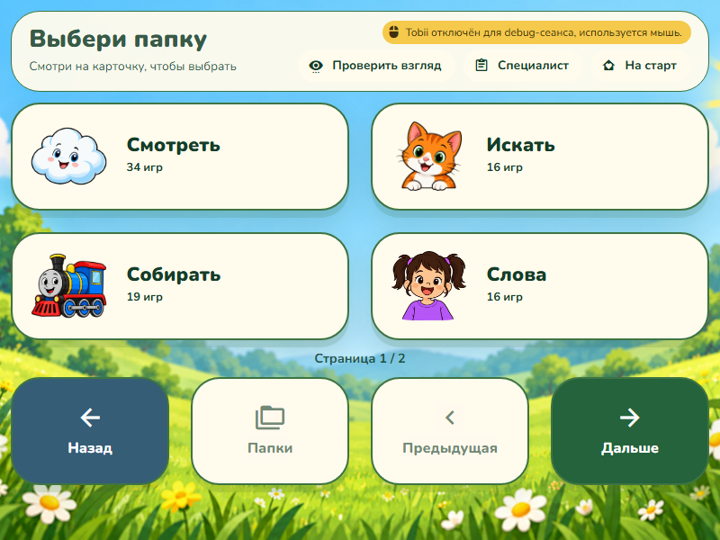
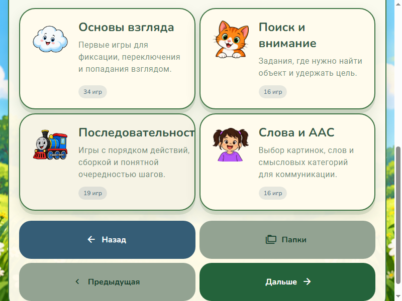
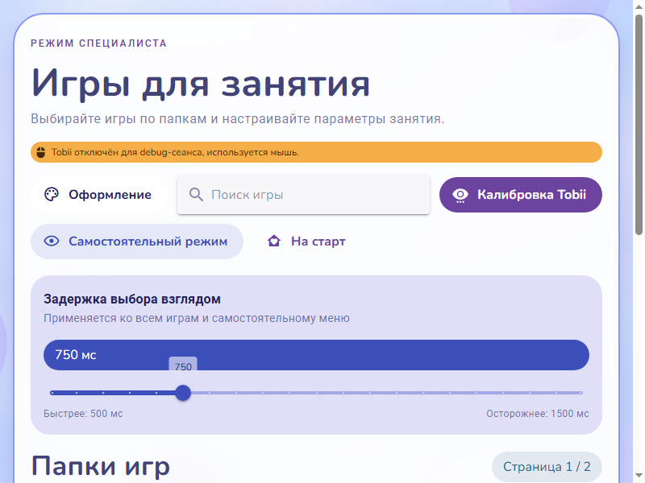

# Стартовый экран и навигация меню

Исправлены пять замечаний:

- Карточки стартового экрана используют одинаковую внутреннюю разметку и нижний отступ. Кнопки «Настроить игру» и «Играть» совпадают по верхнему краю, нижнему краю и высоте при размещении рядом.
- «Назад» в самостоятельном меню всегда доступна и возвращает на `/`.
- «Назад» в каталоге специалиста также всегда возвращает на `/`, включая первую страницу.
- «Оформление» доступно в разделе специалиста; из самостоятельного меню удалены кнопка и диалог настройки темы.
- «Открыть каталог» в стартовой карточке специалиста переименовано в «Настроить игру».

Для сохранения листания добавлена отдельная «Предыдущая»: в самостоятельном меню она занимает место «Оформления», в каталоге расположена рядом с остальными кнопками навигации. Каталог показывает одну кнопку в ряд на телефоне, две от 600 и четыре от 960 CSS-пикселей, чтобы длинная подпись помещалась вместе с иконкой.

## Проверка

- TypeScript, Prettier трёх исходников, adaptive-layout и diff-check прошли.
- Настоящий Electron через CDP: стартовый экран 800×600, 1024×600, 1600×900 и 500×900, каждая из трёх тем. Во всех девяти сочетаниях с карточками рядом координаты CTA совпали с точностью меньше одного CSS-пикселя; на узком экране совпали внутренние нижние отступы и высота CTA.
- Оба меню при ширинах 500, 800 и 1024: «Назад» активна на первой странице, «Предыдущая» корректно отключена; переход на следующую и предыдущую страницу работает; возврат ведёт на старт. Содержимое кнопок не переполняет их ширину.
- Дополнительно каталог при ширинах 375 и 500: одноколоночная навигация, подписи целиком внутри кнопок, листание и возврат работают.
- Подтверждены отсутствие «Оформления» в самостоятельном меню и открытие диалога у специалиста.
- Настоящие mouse events через CDP проверили обе стартовые карточки и возврат из каталога. Синтетический Tobii через dwell coordinator активировал `self-back` и вернул на старт. Физический Tobii не использовался.
- Независимое read-only ревью выявило слишком ранний переход каталога к четырём колонкам; breakpoint исправлен с `sm` на `md` до визуальной проверки.

Локальные проверочные сценарии и результаты: `D:/browser games/issue-qa/start-menu-regression.mjs`, `start-menu-final.mjs`, `start-menu-regression.json`. Проверки выполнялись в отдельном userData, Vite 5174 / Electron CDP 9223.

